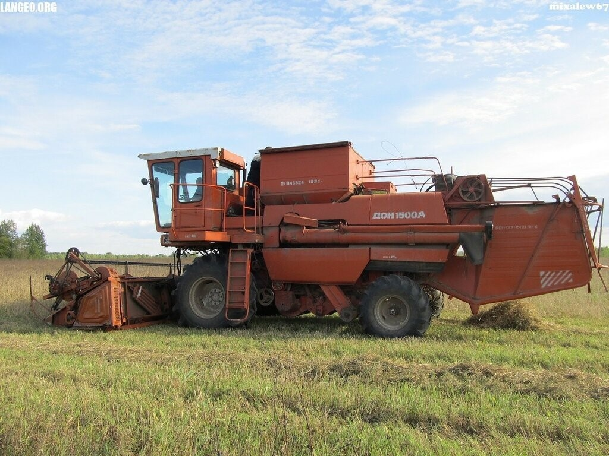

# 🛸 ASTRANOMIA (АСТРАНОМИЯ)
### *Game Design Document & Сценарный план*

> **Слоган:** *«Не лезь в мой огород, зелёный!» / «Жатва галактического масштаба»*  
> **Жанр:** Action-Roguelite / Vehicular Arcade Combat / Defensive Shooter  
> **Сеттинг:** Научно-фантастическая комедия, агро-панк

---

## 🌾 1. КОНЦЕПЦИЯ И ОСНОВА СЮЖЕТА

### 1.1. Происхождение названия
Название **«ASTRANOMIA»** строится на тройной смысловой связке:
1. **Культовый трек «Astronomia» (Tony Igy / Vicetone):** Главная музыкальная тема меню и мем *Coffin Dance* — захватчики прилетели за земным урожаем, но оформили себе галактические похороны прямо на пашне.
2. **Астрономия:** Космос, летающие тарелки, гравитационные лучи и внеземной флот.
3. **Агрономия:** Земледелие, севооборот, бахчевые культуры и тяжелая уборочная техника.

### 1.2. Предыстория вторжения
Внеземная цивилизация с планеты Зоргон-7 страдает от вырождения вкусовых рецепторов из-за тысячелетий питания синтетической пастой. Космический зонд обнаруживает хутор «Нижние Кабачки» на Земле, где зафиксированы залежи сахарозы, крахмала и витаминов — **отборные земные овощи**.

Для инопланетян сортовая тыква и картофель — одновременно высший деликатес и сверхмощное органическое биотопливо. Галактический флот Шеф-Повара Зорга разворачивает операцию по тотальному похищению всего урожая с полей.

---

## 🚜 2. ГЛАВНЫЙ ГЕРОЙ И КОМБАЙН «ДОН-1500» («ДОН-1500А»)

### 2.1. Фермер Дед Макар
Пожилой, суровый механизатор 1-го класса. Носит потертый рабочий комбинезон, кирзовые сапоги и кепку с соломинкой. Всю жизнь посвятил селекции гигантских тыкв и кукурузы. Для Макара вторжение инопланетян — это не контакт с высшим разумом, а наглое посягательство на частную собственность и севооборот.

### 2.2. Легендарный комбайн «ДОН-1500А» (Визуальный канон со скриншота)


В игре используется детально воссозданный легендарный советский комбайн завода «Ростсельмаш» — **«ДОН-1500А»** (выпуск 1991 года), превращенный умелыми руками Макара в боевую крепость на колесах:

* **Цвет и маркировка (строго по фото):**
  * Фирменный заводской **терракотово-красный (кирпично-красный)** цвет всего кузова, слегка патинированный полевой пылью и брызгами чернозёма.
  * На боку крупными белыми трафаретными буквами выведена аутентичная надпись: **«ДОН 1500А»**.
  * На зерновом бункере сверху нанесен заводской штамп: **«№ 045324 1991 г.»**.
* **Кабина и конструкция:**
  * Высокая угловатая застекленная кабина с панорамным обзором, плоской **белой крышей** и металлической приставной лестницей на левом борту.
  * Внутри кабины — штурвал с гидроусилителем, рычаги вариатора, висящие четки, иконка и тумблер включения боевых систем.
* **Ходовая часть и колеса:**
  * Огромные передние ведущие колеса с глубоким тракторным шевронным протектором («ёлочка») — идеально перемалывают сырую пашню и любую внеземную пехоту.
  * Управляемые задние колеса меньшего радиуса, позволяющие тяжелой махине закладывать резкие пахотные заносы (дрифт).
* **Жатка и измельчитель:**
  * **Спереди — массивная зерновая жатка:** мотовило со стальными граблинами и режущий аппарат. На скорости они затягивают пришельцев под вращающийся шнек, превращая их в биоперегной.
  * **Сзади — измельчитель-копнитель** с характерной **бело-красной диагональной предупреждающей штриховкой**, выбрасывающий перемолотые остатки захватчиков обратно на поле для удобрения.
* **Труба выгрузного шнека вдоль борта:**
  * Длинная толстая труба шнека вдоль правого борта комбайна модернизирована: теперь это мощный пневматический метатель клубней картофеля крупного калибра.
* **Орудийная зенитная платформа на крыше:**
  * На крыше рядом с бункером смонтирована турель с независимым прицеливанием на 360 градусов для уничтожения летающих тарелок в воздухе.
* **Силовая установка:**
  * Турбодизель V8 (ЯМЗ-238) с характерным утробным басовитым рычанием, дополненный системой впрыска первача («Самогонный форсаж»).

---

## 🎯 3. ДВУХУРОВНЕВЫЙ ГЕЙМПЛЕЙНЫЙ ЦИКЛ (DUAL-LAYER COMBAT)

```
                  ┌─────────────────────────────────────────┐
                  │          НЕБО: ЛЕТАЮЩИЕ ТАРЕЛКИ         │
                  │  (Стрельба из турелей комбайна / Мышь)  │
                  └────────────────────┬────────────────────┘
                                       │ ⚡ Тяговые лучи (Tractor Beams)
                                       │ похищают тыквы и картофель!
                                       ▼
  ┌────────────────────────────────────────────────────────────────────────┐
  │                         ЗЕМЛЯ: ПРИШЕЛЬЦЫ-ПЕХОТИНЦЫ                     │
  │     (Управление комбайном: давка колесами, распил жаткой / WASD)       │
  └────────────────────────────────────────────────────────────────────────┘
```

1. **Земля (давка пехоты):**
   * Пришельцы десантируются из тарелок, выкапывают корнеплоды и тащат их к лучам захвата.
   * Игрок на комбайне сбивает строй врагов, перемалывает их жаткой и давит катками.
   * Раздавленные враги дают «Биотопливо» для ускорения и заполняют шкалу ультимейта.

2. **Воздух (уничтожение летающих тарелок):**
   * Летающие тарелки зависают над грядками и включают фиолетовые тяговые лучи (Tractor Beams), медленно поднимая овощи в небо.
   * Игрок целится из зенитного вооружения на кабине комбайна, сбивая летающие тарелки или срубая луч. Если тарелка сбита — овощ падает обратно на поле и сохраняется.

3. **Условие победы и поражения:**
   * На каждом уровне есть счетчик урожая (центнеры моркови, тыквы, кукурузы).
   * Если пришельцы украдут более 50% урожая или взорвут комбайн — уровень провален.

---

## 🔫 4. АРСЕНАЛ ВООРУЖЕНИЯ ПРОТИВ ЛЕТАЮЩИХ ТАРЕЛОК

Для сбивания летающих тарелок комбайн оборудован специальным зенитным оружием:
1. **Дедов зенитный обрез:** Крупнокалиберный двуствольный дробовик. Наносит сокрушительный урон по низколетящим блюдцам-разведчикам в упор.
2. **Пневматическая картофелепушка «Крахмал-1»:** Стреляет твердыми клубнями картофеля на гиперзвуке. Сбивает гравитационные щиты тарелок и глушит электронику.
3. **Пулемет «Gatling-Corn»:** Скорострельная турель с ленточной подачей початков кукурузы. При длительной очереди стволы раскаляются, и зерна вылетают в виде разрывного взрывного попкорна.
4. **Ракетный комплекс «Огурчик-С»:** Залповая система реактивных соленых огурцов с тепловым наведением на плазменные двигатели НЛО.
5. **Тесла-вилы (Электро-гарпун):** Выстреливает электрический кабель в днище тарелки, обесточивает ее и притягивает летающую тарелку прямо под ножи жатки комбайна.

---

## 🎬 5. СЮЖЕТНАЯ КАМПАНИЯ

* **Акт I: «Ночь падающих звезд»** — Первая атака на огуречные теплицы. Макар заводит комбайн, шинкует передовой отряд и монтирует зенитку.
* **Акт II: «Кукурузный лабиринт»** — Высокая кукуруза скрывает пришельцев. Макар прорубает просеки, ориентируясь на тени летающих тарелок на пашне.
* **Акт III: «Осенняя распутица»** — Грязь и дождь. Пришельцы используют тяжелые тарелки-экстракторы. Макар ставит комбайн на гусеницы и сбивает тарелки картофелепушкой.
* **Акт IV: «Финальная жатва»** — Битва против космического корабля-соковыжималки Верховного Шеф-Повара Зорга. Макар взлетает на комбайне со скирды сена и перемалывает генератор флагмана.
* **Эпилог:** Обломки тарелок превращены в теплицы, пленные инопланетяне пропалывают бураки под надзором пса Барбоса, а Макар получает золотую медаль на ярмарке.
